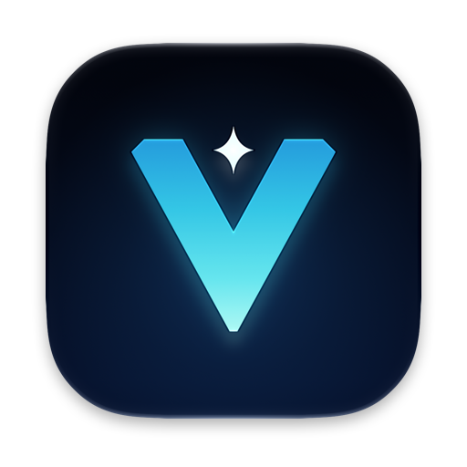
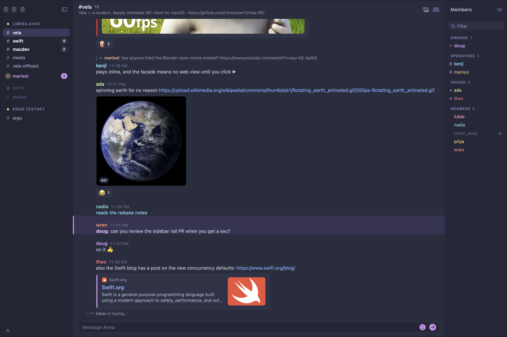
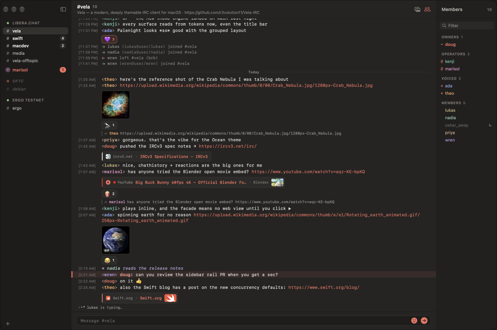

<p align="center">
  
</p>

<h1 align="center">Vela</h1>

<p align="center">
  A modern, deeply themable IRC client for macOS.<br>
  IRCv3 · inline media · on-device Apple Intelligence · VS Code-style themes
</p>

<p align="center">
  <a href="https://github.com/r3volution11/Vela-IRC/releases/latest/download/Vela.dmg"><b>Download for macOS</b></a> ·
  <a href="https://velairc.app">Website &amp; docs</a> ·
  <a href="CHANGELOG.md">Changelog</a> ·
  <a href="ROADMAP.md">Roadmap</a>
</p>

<p align="center">
  <a href="https://github.com/r3volution11/Vela-IRC/releases/latest"></a>
  <a href="https://github.com/r3volution11/Vela-IRC/actions/workflows/ci.yml"></a>
  
  <a href="LICENSE"></a>
</p>

<p align="center">
  
</p>

<table>
  <tr>
    <td></td>
    <td></td>
  </tr>
  <tr>
    <td align="center"><sub>Focus preset · pill tab stacks in the title bar</sub></td>
    <td align="center"><sub>Classic IRC preset · Vela Graphite</sub></td>
  </tr>
</table>

## Contents

- [Install](#install)
- [Why Vela?](#why-vela)
- [Features](#features)
- [Getting started](#getting-started)
- [Keyboard shortcuts](#keyboard-shortcuts)
- [Customizing Vela](#customizing-vela)
- [Privacy](#privacy)
- [Building from source](#building-from-source)
- [Project layout](#project-layout)
- [Contributing](#contributing)
- [License and credits](#license-and-credits)

## Install

1. Download **[Vela.dmg](https://github.com/r3volution11/Vela-IRC/releases/latest/download/Vela.dmg)**, the latest release.
2. Open it and drag **Vela** into **Applications**.
3. Launch Vela from Applications or Spotlight.

Requirements:

- macOS 26 Tahoe or later, on Apple silicon or Intel.
- Releases are signed with a Developer ID and notarized by Apple, so they open without security warnings.

The full user guide is at **[velairc.app](https://velairc.app)**.

## Why Vela?

IRC is simple, open and everywhere, but IRC clients on the Mac have stood still. Vela pairs IRC's simplicity with what people now expect from chat: inline media, reactions, replies and a polished native interface. It is built around one idea: **make Vela work the way you want.**

- **Every pixel is themable.** You can import [VS Code](https://code.visualstudio.com) themes, edit themes live and override any color from `settings.json`.
- **Navigation is your choice.** Use a sidebar (or a thin rail) if you're on many networks, or [Vivaldi](https://vivaldi.com)-style tab stacks if you're on a few.
- **Three message layouts.** Pick Classic one-line, Modern grouped, or Compact columns.
- **Presets get you started.** Each preset sets up a whole style in one click, so you don't have to get into the weeds.

## Features

### Themes everywhere

- **Every surface** draws from named color tokens, the way VS Code themes work: the title bar, sidebar and rail, tabs, chat, input, member list, embeds and settings.
- **21 built-in themes:**
  - Material-inspired: Palenight (default dark), Lighter (default light), Oceanic, Darker, Ocean, Deepforest, Volcano and Sandy Beach.
  - Vela originals: Vela Graphite, Vela Paper and Vela Mist.
  - Ports of popular editor themes: [Dracula](https://draculatheme.com), [Nord](https://www.nordtheme.com), [Catppuccin](https://catppuccin.com) Latte and Mocha, [Tokyo Night](https://github.com/tokyo-night/tokyo-night-vscode-theme), [One Dark](https://binaryify.github.io/OneDark-Pro/), [Gruvbox](https://github.com/morhetz/gruvbox) Dark, [Solarized](https://ethanschoonover.com/solarized/) Dark and Light, and [Rosé Pine](https://rosepinetheme.com).
- **Select Theme** in the command palette previews each theme live as you move through the list.
- **Accent colors:** switch a theme's accent to one of its own colors in Settings → Appearance. Each theme keeps its own choice, and text stays readable.
- **Follows macOS** light and dark appearance, using a preferred theme for each.
- **Theme editor** with color wells for every token, contrast warnings and live preview of the whole app.
- **Import VS Code themes** (`.json` or `.vsix`). Editor, sidebar, list, input, badge and terminal ANSI colors map onto Vela's tokens automatically.
- **Theme files are JSON (comments allowed),** with `include` for inheritance and a published JSON Schema for autocomplete. They reload live as you edit them.
- **`appearance.colorCustomizations`** in `settings.json` overrides any token, globally or for one theme (`"[Palenight]": { … }`).

### Navigation and layout

- **Sidebar:** a compact network/channel tree with unread and mention badges. It collapses to a thin icon rail, and the window buttons stack vertically to fit. Hover the rail to peek at the full tree.
- **Tab stacks:** Vivaldi-style two-level tabs, with networks on top and that network's channels below.
  - Place them **at the top**, **in the title bar** or **above the input**.
  - Corners range from square to pill.
  - The network row hides automatically when you're on a single network.
- **Leave, remove and reopen:** **Leave Channel** keeps a channel in the list, dimmed; a tab's × and **Remove Channel…** take it out, and off the network's auto-join list. Through ZNC or soju, leaving detaches the channel instead, so the bouncer stays in it and keeps its history, and a detached channel can be hidden. ⌘Z undoes each, and ⇧⌘T or **File → Recently Closed** reopens removed and hidden channels and closed conversations where they were.
- **Message layouts:**
  - **Classic** — `[12:01] <nick> text`
  - **Modern grouped** — one name header per run of messages
  - **Compact columns** — time, right-aligned nick, then text
- **Density controls:** fonts (including a monospace mode), line and message spacing, timestamps, nick colors and optional avatars. Join/part/quit noise can be shown, collapsed into one line, or hidden.

### Presets

One click sets navigation, layout, density and media together. Presets never touch your theme, and you can keep tweaking afterwards.

| Preset | What you get |
|---|---|
| **Classic IRC** | Sidebar, one-line monospace messages, dense spacing, minimal link previews |
| **Modern Chat** | Sidebar, grouped messages, full inline media |
| **Tabbed** | Tab stacks at the top, grouped messages, rounded tabs |
| **Focus** | Pill tabs in the title bar, compact columns, no join/part noise, member list hidden |

### Messages and media

- **Inline images and animated GIFs.** Click one to view it full size.
- **Link previews** with the page title, description, site name and thumbnail, accented with the page's own theme color.
- **Video players** for YouTube, Vimeo, Twitch, Streamable and Reddit. The player loads only when you press play, and you can expand it to fill the window.
- **GIFs from Tenor, GIPHY and Imgur** play inline, even from a link to the GIF's page. The website lists [every supported media site](https://velairc.app/reference/media-sites) and the links Vela recognizes on each; that list is generated from the code and checked against the real sites every week.
- **Your choice of size:** Minimal, Standard or Large link previews, full or compact videos, and full-size or thumbnail images.
- **Site rules and an adult-site filter:** show everything, text only or nothing per site. Adult sites' previews are hidden by default, checked on your Mac against a list bundled with Vela. Images can stay blurred until clicked.
- **[mIRC](https://www.mirc.com) formatting:** bold, italic, underline, strikethrough, monospace, colors (including hex) and reverse.
- **Reactions, replies, typing indicators and message deletion,** where the server supports IRCv3 message tags.
- **Day dividers, a "New" marker** at your last read position, and a "Jump to present" button.

### Apple Intelligence, Siri and Shortcuts

- **Catch me up:** back in a busy channel, an Apple Intelligence summary of what you missed, topic by topic, made on your Mac.
- **Translation:** translate a message from another language, or a whole channel as messages arrive, on your Mac with Apple's Translation framework. No Apple Intelligence needed.
- **Writing Tools** in the message field, where Apple Intelligence is available.
- **Siri and Shortcuts:** ask Siri to catch you up, check your mentions, send a message, open a channel or set you away, and use the same actions in your own shortcuts. Your channels show up in Spotlight (names only).

### IRC done properly

- **Secure connections:** TLS with certificate validation, plus an opt-in "Allow invalid certificates" for self-signed bouncers.
- **Authentication:** SASL PLAIN and EXTERNAL, client certificates, and server passwords. All secrets live in the macOS Keychain.
- **IRCv3:**
  - `server-time`, `echo-message`, `batch`, `labeled-response`, `chathistory`
  - `message-tags`, `away-notify`, `account-notify`, `extended-join`, `multi-prefix`, `userhost-in-names`
  - `setname`, `chghost`, `invite-notify`, `cap-notify`, STS, `message-redaction`
- **Reconnection:** automatic, with backoff, including after sleep/wake and network changes.
- **Bouncers:**
  - **[ZNC](https://znc.in):** server-password login, `self-message`, `playback`, server-time.
  - **[soju](https://soju.im):** your bouncer's networks appear automatically, and history comes from `chathistory`.
- **Scrollback:** stored locally in SQLite with full-text indexing. Older history is paged in from disk, then from the server.

### Fast to drive

- **Command palette** (⇧⌘P) runs any command: layouts, presets, themes, network actions, settings and more.
- **Settings editor:** every setting in one searchable list, VS Code style, with filters such as `@modified`, plus a JSON view of `settings.json` that suggests settings and values, flags mistakes as you type and shows docs on hover.
- **Quick switcher** (⌘P or ⌘K) jumps to any channel or conversation with fuzzy search.
- **Composer:** Tab completion for nicks, channels, `/commands` and `:emoji:` shortcodes, plus per-channel history and drafts. Pasting multiple lines asks for confirmation before sending.
- **Typing options:** spelling, grammar, autocorrect, text replacements and smart quotes, following your Mac's settings until you change them. Commands, nicks, channel names, links and code are never corrected.
- **User menu:** right-click a nick in the member list or in a message for Message, Mention, Whois, Ping, CTCP, Invite and Ignore, plus the ops, voices, kicks, bans and quiets your rank in the channel allows. Select several people in the member list to act on them all.
- **Slash commands:**
  - `/join`, `/part`, `/msg`, `/query`, `/me`, `/nick`, `/topic`, `/away`, `/whois`
  - `/mode`, `/kick`, `/kickban`, `/ban`, `/quiet`, `/op`, `/voice`, `/invite`
  - `/ctcp`, `/ping`, `/version`, `/raw`, `/ignore`, `/close`, `/clear`, `/quit`
  - Any other command is sent to the server as typed.

## Getting started

1. Open Vela and click **Add Network…** (⇧⌘N).
2. Pick a preset such as Libera.Chat or OFTC, or enter a server, port and nickname yourself.
3. Choose how to sign in: SASL for most networks, a server password for ZNC, or a client certificate.
4. Click **Save**. Vela connects and joins your auto-join channels. Press ⌘J to join more.

**Connecting through ZNC:** turn on **Bouncer → ZNC** and use your ZNC password in the form `username/network:password`. If your ZNC listener doesn't use TLS, turn TLS off for that network. If it uses a self-signed certificate, turn on **Allow invalid certificates** instead. Vela and your other clients can stay connected to ZNC at the same time.

**Connecting through soju:** turn on **Bouncer → soju**. Vela lists the networks on your bouncer and connects to each one.

## Keyboard shortcuts

| Action | Shortcut |
|---|---|
| Command palette | ⇧⌘P |
| Go to channel or conversation | ⌘P or ⌘K |
| Select theme | ⌃⌘T |
| Show/hide member list | ⇧⌘M |
| Collapse/expand sidebar | ⌃⌘S |
| Previous / next conversation | ⌥⌘↑ / ⌥⌘↓ |
| Next unread | ⌥⇧⌘↓ |
| Focus the message field | ⌘L |
| Add network | ⇧⌘N |
| Join channel | ⌘J |
| Reopen closed channel or conversation | ⇧⌘T |
| Undo leaving, removing or closing | ⌘Z |
| Bigger / smaller / actual-size text | ⌘+ / ⌘− / ⌘0 |
| Settings | ⌘, |

## Customizing Vela

- **Settings** (⌘,) has panes for Presets, Appearance, Layout, Messages, Media, Networks, Notifications, Apple Intelligence and Advanced. Every change applies immediately, and the search field at the top of the sidebar finds any setting.
- **Settings → Advanced** is a VS Code-style settings editor: every setting with the right control for it, search and filters (`@modified`, `@unknown`, `@category:`, `@pane:`), and a JSON view with suggestions, inline problems, hover docs and the defaults alongside.
- **`settings.json`** holds everything, VS Code style. Edit it in the settings editor's JSON view, or open it in your own editor from **Theme → Open settings.json**. Edits made in any editor apply live, and changes made in Vela keep your comments and formatting. Example:

  ```jsonc
  {
    "appearance.theme": "Tokyo Night",
    "appearance.followSystem": false,
    "appearance.colorCustomizations": {
      "chat.background": "#16161e",
      "[Tokyo Night]": { "accent": "#ff9e64" }
    },
    "navigation.style": "tabs",
    "tabs.placement": "titleBar",
    "tabs.roundness": 1,
    "chat.layout": "columns",
    "chat.showJoinPart": "hide",
    "media.siteRules": { "example.com": "block", "news.example": "textOnly" }
  }
  ```

- **Themes folder.** Choose **Theme → Reveal Themes Folder**, drop theme files in, and they appear immediately. See the [theme authoring guide](docs/THEMES.md) and the [JSON Schema](schemas/vela-theme.schema.json).

## Privacy

- **No telemetry, analytics or accounts.** Vela talks only to the IRC servers you add.
- **Link previews** fetch the linked page or image, which reveals your IP address to that site. You can control this:
  - Turn previews off entirely, or switch to click-to-load.
  - Disable media for a network or channel.
  - Set per-site rules: everything, text only or nothing.
- **No previews from your local network.** Vela never fetches previews from private, local or LAN addresses.
- **Passwords and certificates** are stored in the macOS Keychain. Vela is sandboxed.
- **On-device intelligence.** Catch me up summaries and translations are made on your Mac. Spotlight gets channel names only, and Siri learns which channels you message, never what you wrote.
- **The website is separate.** velairc.app uses Google Analytics, asks visitors in the EU, EEA, UK and Switzerland first, and honors Global Privacy Control. The app never does any of this. See [Privacy](https://velairc.app/help/privacy#this-website).

## Building from source

You need Xcode 27 or later.

```sh
git clone git@github.com:r3volution11/Vela-IRC.git
cd Vela-IRC
scripts/run.sh               # build (Release) and launch build/Vela.app
scripts/run.sh --dev         # build (Debug) and launch "build/Vela Dev.app"
scripts/run.sh --demo        # launch with offline sample content
```

Or open `Vela.xcodeproj` in Xcode (the project file, not the folder), choose the **Vela** scheme and **My Mac**, and press ⌘R.

**Release and development builds run side by side.** Debug builds (`scripts/run.sh --dev`, or ⌘R in Xcode) are a separate app, **Vela Dev** (bundle id `io.github.r3volution11.Vela.dev`), with a **DEV** badge on its Dock icon. Because macOS keys an app's sandbox to its bundle id, Vela Dev has its own settings, networks, message history, Keychain items, notifications and Siri & Shortcuts registration. So you can keep your everyday Vela connected while you test changes, and nothing you do in the dev build touches it. `scripts/run.sh` with no flag builds the Release configuration as `build/Vela.app`, the same identity that `scripts/release.sh` signs and ships.

```sh
swift test --package-path Packages/VelaKit                    # unit tests (1,200+)
VELA_LIVE_TESTS=1 swift test --package-path Packages/VelaKit \
  --filter "LiveNetwork|LiveSession"                          # live TLS + IRCv3 checks against public servers
scripts/check-media-sites.sh                                  # check the supported media sites against the real sites
scripts/demo-screenshot.sh build/Vela.app shot.png --theme Lighter --preset tabbed   # offscreen screenshot
scripts/demo-screenshot.sh build/Vela.app shot.png --themes-dir my-themes --theme "Harbor"  # with themes from a folder
```

Demo mode uses a temporary Themes folder, so it never shows or changes your
own themes; `--themes-dir <folder>` copies a folder's theme files into it.

To build a signed and notarized release, see [docs/RELEASING.md](docs/RELEASING.md). Start with `scripts/release.sh --preflight`, which checks that everything is ready (git, version and changelog, CI, tests, website, generated files, media sites) and builds nothing. Then `scripts/release.sh --publish` builds, checks, tags and publishes the release on GitHub.

## Project layout

```
Vela/                    Thin macOS app target (entry point, app icon, entitlements)
Packages/VelaKit/
  Sources/VelaIRC        IRC protocol, IRCv3 negotiation, SASL, TLS connection
  Sources/VelaStore      SQLite scrollback, settings.json, networks, Keychain, presets
  Sources/VelaTheme      Token registry, theme loading, VS Code import, live reload
  Sources/VelaMedia      Link detection, previews, images, video embeds
  Sources/VelaCore       App and session models tying it together
  Sources/VelaIntelligence Catch me up summaries and message translation (Apple Intelligence, Translation)
  Sources/VelaIntents    Siri, Shortcuts and Spotlight (App Intents)
  Sources/VelaUI         SwiftUI views, scenes, command palette
schemas/                 JSON Schema for theme files
website/                 velairc.app (VitePress)
docs/                    Theme authoring guide, credits, release process
design/app-icon/         App icon generators and geometry (see its README)
scripts/                 run, release, screenshot, icon export and media site check tools, git hooks
```

## Getting help

Ask in **#vela** on **Libera.Chat**, Vela's own channel: server `irc.libera.chat`, port 6697 with TLS, or [web chat](https://web.libera.chat/#vela). Report bugs and request features in [GitHub issues](https://github.com/r3volution11/Vela-IRC/issues/new/choose). The [user guide](https://velairc.app) covers every feature, and its [troubleshooting page](https://velairc.app/help/troubleshooting) the common problems.

## Contributing

Contributions are welcome, especially themes. See [CONTRIBUTING.md](CONTRIBUTING.md). The [roadmap](ROADMAP.md) lists what's planned next, including image uploads, search, iCloud sync and auto-updates.

## License and credits

Vela is licensed under the [Mozilla Public License 2.0](LICENSE):

- You can use, modify and distribute it, including in paid or App Store builds.
- Changes to Vela's own source files must stay open.

Third-party components and ported themes keep their own licenses. See [THIRD_PARTY_NOTICES.md](THIRD_PARTY_NOTICES.md) and [docs/THEME-CREDITS.md](docs/THEME-CREDITS.md). The Material-inspired themes are original designs inspired by the classic Material Theme palettes; Vela is not affiliated with Material Theme or Vira Software.

### Acknowledgements

Vela builds on a lot of other people's work. Thank you to:

- **Apple's platform:** Vela is written in [Swift](https://www.swift.org) with [SwiftUI](https://developer.apple.com/swiftui/) and AppKit, and uses Network, WebKit, AVKit, Foundation Models, Translation, Natural Language, App Intents, Core Spotlight and more. It's built in [Xcode](https://developer.apple.com/xcode/) and tested with Swift Testing, and the icon was made in [Icon Composer](https://developer.apple.com/icon-composer/).
- **Libraries:** [GRDB.swift](https://github.com/groue/GRDB.swift) (MIT) on macOS's [SQLite](https://www.sqlite.org) for the message database, and [ZIPFoundation](https://github.com/weichsel/ZIPFoundation) (MIT) for `.vsix` theme import.
- **Data:** [Sinfonietta/hostfiles](https://github.com/Sinfonietta/hostfiles) (MIT) for the adult-site filter's domain list.
- **IRC documentation:** the [Modern IRC Client Protocol](https://modern.ircdocs.horse/) and its formatting and CTCP specs, the [IRCv3 specifications](https://ircv3.net/irc/), and RFC 1459 and 2812.
- **Theme palettes:** Dracula, Nord, Catppuccin, Tokyo Night, One Dark Pro, Gruvbox, Solarized and Rosé Pine, with the Material Theme and [Bear](https://bear.app) as inspiration ([details](docs/THEME-CREDITS.md)).
- **The website:** [VitePress](https://vitepress.dev), Vue, Vite, Shiki and MiniSearch.
- **Screenshot media:** *Big Buck Bunny* (© 2008 Blender Foundation, CC BY 3.0), an ESO image (ESO/VVVX survey, CC BY 4.0), and public-domain images and animations from NASA, ESA and the U.S. Air Force, via Wikimedia Commons, GIPHY and Tenor.

The full list, with links and licenses, is at **[velairc.app/help/license](https://velairc.app/help/license)**.

---

<sub>Vela was made with the help of AI. Its source code is open, so anyone can read exactly what it does.</sub>
