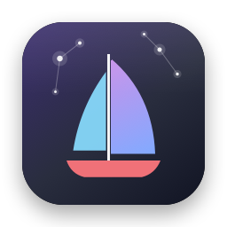
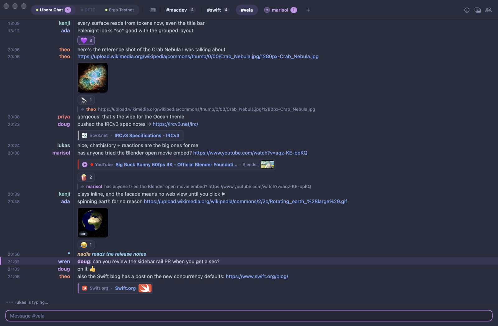

<p align="center">
  
</p>

<h1 align="center">Vela</h1>

<p align="center">
  A modern, deeply themable IRC client for macOS.<br>
  Native SwiftUI · IRCv3 · inline media · VS Code-style themes
</p>

---

> **Status: early development.** Vela is being built in the open. Expect rough edges and breaking changes until the first tagged release. See [ROADMAP.md](ROADMAP.md).

<p align="center">
  
</p>

<table>
  <tr>
    <td></td>
    <td></td>
  </tr>
  <tr>
    <td align="center"><sub>Focus preset · pill tab stacks in the title bar</sub></td>
    <td align="center"><sub>Classic IRC preset · Vela Graphite</sub></td>
  </tr>
</table>

<sub>Screenshots are from demo mode (<code>Vela --demo</code>) and generated with <code>scripts/demo-screenshot.sh</code>.</sub>

## Why Vela?

IRC clients on the Mac have stood still. Vela pairs the protocol's simplicity with what people now expect from chat:

- **The whole app is themable.** Every surface (title bar, sidebar, chat, input, member list, embeds, settings) reads from named color tokens, just like VS Code.
  - Themes are JSON files.
  - User overrides go in `settings.json`.
  - Edits reload live.
  - **Any VS Code theme can be imported** as a `.json` or `.vsix` file.
- **Inline media, Discord-style.**
  - Images and animated GIFs show inline.
  - Links become cards with the page's title, description and thumbnail.
  - YouTube, Vimeo, Twitch and Streamable links play inline.
  - Every bit of it is configurable: per network, per channel, or with domain allow/block lists.
- **Modern IRC.** Vela speaks IRCv3:
  - Reactions, replies, typing indicators and message redaction.
  - `server-time`, `chathistory`, SASL and client certificates.
  - First-class **soju** and **ZNC** bouncer support.
- **Your layout, your rules.**
  - Navigate with a compact sidebar (it collapses to a thin rail) or with Vivaldi-style two-level **tab stacks**. Tabs can sit at the top, in the title bar or above the input, with corners from square to pill.
  - Three message layouts: Classic `[12:01] <nick> text`, Modern grouped (Slack/Discord-style) and Compact columns.
  - Adjustable fonts, spacing, timestamps and join/part display.
- **One-click presets.** Classic IRC, Modern Chat, Tabbed and Focus set up navigation, layout, density and media in one step. Your theme is never touched, and you can keep tweaking afterward.
- **Native and fast.** Swift 6, SwiftUI and Network.framework. No web views except for the video players themselves.

## Built-in themes

| Family | Themes |
|---|---|
| Inspired by Material Theme | Oceanic, Darker, **Palenight** (default dark), Ocean, Deepforest, Volcano, **Lighter** (default light), Sandy Beach |
| Vela originals | Vela Graphite, Vela Paper, Vela Mist |
| VS Code favorites | Dracula, Nord, Catppuccin Latte, Catppuccin Mocha, Tokyo Night, One Dark, Gruvbox Dark, Solarized Dark, Solarized Light, Rosé Pine |

See [docs/THEMES.md](docs/THEMES.md) to write your own and [docs/THEME-CREDITS.md](docs/THEME-CREDITS.md) for attribution.

## Requirements

- macOS 26 Tahoe or later
- Building from source requires Xcode 27 or later.

## Building

```sh
git clone git@github.com:r3volution11/Vela-IRC.git
cd Vela-IRC
open Vela.xcodeproj          # then Run (⌘R)
```

Almost all code lives in the `VelaKit` Swift package, so you can run the tests without Xcode's UI:

```sh
swift test --package-path Packages/VelaKit
```

## Project layout

```
Vela/                    Thin macOS app target (entry point, assets, entitlements)
Packages/VelaKit/
  Sources/VelaIRC        IRC protocol, IRCv3 negotiation, SASL, connection
  Sources/VelaStore      SQLite scrollback (GRDB), settings.json, networks, Keychain
  Sources/VelaTheme      Token registry, theme loading, VS Code import, live reload
  Sources/VelaMedia      Link detection, previews, images, video embeds
  Sources/VelaCore       App and session models tying it together
  Sources/VelaUI         SwiftUI views and scenes
schemas/                 JSON Schema for theme files
docs/                    Theme authoring guide and credits
```

## Contributing

Contributions are welcome, especially themes. See [CONTRIBUTING.md](CONTRIBUTING.md).

## License

Vela is licensed under the [Mozilla Public License 2.0](LICENSE). In short:

- You can use, modify and distribute Vela, including in paid or App Store builds.
- Changes to Vela's own source files must stay open under the MPL.

Third-party components and themes keep their own licenses. See [THIRD_PARTY_NOTICES.md](THIRD_PARTY_NOTICES.md).
