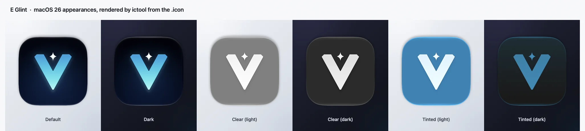

# Vela app icon: "Glint"

A pointed **V** on a smooth navy ground, lit by a soft glow, with one small four-point star in its notch. *Vela* is Latin for "the sails", and it's also the name of a southern constellation: the star is a nod to the constellation. The V is Liquid Glass, and so is the star, which sits on its own layer.

Glint is concept E from [`concepts/`](concepts/README.md), the round of six V concepts that replaced **Horizon Sail** in November 2026. Horizon Sail is kept in [`archive/horizon-sail/`](archive/horizon-sail/README.md).

## Files

- **[`Vela/AppIcon.icon`](../../Vela/AppIcon.icon)** is the icon itself, an Icon Composer document. Xcode compiles it into the app (`Assets.car` and `AppIcon.icns`), with macOS 26 Liquid Glass and the Default, Dark, Clear and Tinted appearances. It's generated by `build.sh`: you can open it in Icon Composer (Xcode → Open Developer Tool → Icon Composer) to try things, but carry any change back into `concepts.py`, or the next build overwrites it.
- **[`concepts/src/concepts.py`](concepts/src/concepts.py)** is the source of truth. `concept_glint()` holds the geometry, `COLORWAYS` the palettes, and `write_icon()` the Icon Composer layers.
- **`build.sh`** regenerates `Vela/AppIcon.icon` and the Dock icons, then renders previews of every appearance.
- **[`Packages/VelaKit/Sources/VelaUI/Resources/AppIcons/`](../../Packages/VelaKit/Sources/VelaUI/Resources/AppIcons)** holds the Dock icons (see [below](#dock-icons)), one 256 px PNG per colourway.
- **[`concepts/`](concepts/README.md)** is the exploration: six concepts, their renders, and the colourways of the finalists and of Glint ([`alternates-sheet.webp`](concepts/alternates-sheet.webp)).

## Changing the icon

1. Edit `concept_glint()` or the `COLORWAYS` in `concepts/src/concepts.py`.
2. Run `design/app-icon/build.sh` and check the previews. They're Display P3, so view them in a colour-managed app such as Preview.
3. To refresh the concept renders and sheets too, run `design/app-icon/concepts/src/build.sh`.
4. Run `scripts/export-icon.sh` to refresh the README icon and the website's favicons, logo and home-page icon.
5. To refresh the social card, run `website/scripts/screenshots.sh <path to Vela.app> og-image`.

## Geometry

Coordinates are on the 1024-point icon body (Icon Composer's canvas), with y growing downward. On the macOS grid, the body is drawn 824 px wide in a 1024 px canvas.

| Part | Value |
|---|---|
| V | 596 pt wide frame, top at y 262, point at y 806; visible box 233–791 × 262–787 |
| Stroke | 140 pt, perpendicular to the edge; arms 28.7° from vertical |
| Chamfer | 54 pt along the top edge, cut at 45°, outer top corners only |
| Point | trimmed flat 22 pt up each edge, so it stays crisp |
| Notch | inner edges meet at y 515 |
| Star | four points with concave sides, 56 × 66 pt half-size, centred on the axis at y 292 |
| Glow | radial bloom at (512, 600), 560 pt radius, plus the V's silhouette blurred 40 pt σ at 55% |

## Layers and appearances

| Icon Composer element | Content | Default | Dark | Clear | Tinted |
|---|---|---|---|---|---|
| Document fill | Linear navy gradient, top → 78% | `#03050D` → `#09122B` | `#020309` → `#070E23` | System glass | System tint |
| Back group, `glow` (glass off) | Bloom + blurred V | Shown | Opacity 0.85 | Not visible | Hidden |
| Front group, `v` (Liquid Glass) | The V: `#B4FAF4` → `#66E6EE` → `#34C6E6` → `#2296DA`, bright at the point | Specular rim, layer-colour shadow at 0.5, translucency off | Same | White glass V | `v-mono.svg`, tinted |
| Front group, `accent` (Liquid Glass) | The star: `#FFFFFF` → `#DBFFFF` | Shown | Same | Glass | `accent-mono.svg`, tinted |

Liquid Glass is never applied to the glow: glass outlines the alpha of any soft shape, which would turn the glow into a visible disc.

## Dock icons {#dock-icons}

**Settings → Appearance → Dock icon** (`appearance.appIcon` in settings.json) offers the standard icon and five colourways of it:

| Colourway | Background | V, point → top | Star |
|---|---|---|---|
| Vela (standard) | `#03050D` → `#09122B` | `#B4FAF4` `#66E6EE` `#34C6E6` `#2296DA` | `#FFFFFF` → `#DBFFFF` |
| Midnight | `#010208` → `#060B1E` | `#F2FFFD` `#DBFFFF` `#9EFAFF` `#5FB8E8` | `#FFFFFF` → `#DBFFFF` |
| Graphite | `#16181C` → `#2A2D33` | `#FFFFFF` `#ECEFF3` `#C9D0D8` `#9AA4B0` | `#FFFFFF` → `#ECEFF3` |
| Sunrise | `#070A1C` → `#1B1438` | `#FFF1C9` `#FFC98A` `#FF9A6B` `#F2667A` | `#FFF6DC` → `#FFC98A`, warm like the V's point |
| Paper | `#FBFCFE` → `#E2E9F2` | `#34C6E6` `#2296DA` `#1A6FB8` `#0A3E7A` | `#1A6FB8` → `#0A3E7A`, deep like the V's top |
| Vivid | `#2AB4EA` → `#1E50D6` | `#FFFFFF` → `#D2F4FA` | `#FFFFFF` |

How it works, and why it's limited to the Dock:

- **macOS has no alternate-icon API for Mac apps**, and a sandboxed app can only read its own bundle. Changing the bundle's icon (`NSWorkspace.setIcon`) would also put a file inside the signed app. See [`concepts/README.md`](concepts/README.md#alternate-icons-on-macos-what-we-can-promise) for the research.
- **So Vela sets `NSApplication.applicationIconImage`** once it has finished launching, and again whenever the setting changes (`DockIconController` in `VelaUI/Foundation/DockIcon.swift`). That changes the Dock tile and the app switcher while Vela runs.
- **Each colourway is a flat image:** ictool's Default render on the macOS grid (margins and shadow included), at 256 px, the Dock's largest tile on a Retina display. It doesn't follow Dark, Clear or Tinted.
- **The standard icon is never an image:** choosing Vela sets `nil`, which restores the compiled `AppIcon.icon` with its system styling. Its PNG is only the picker's thumbnail.
- **Finder, Spotlight, the Apps list and Vela's icon while it's quit** always show the standard icon, which follows the Icon & widget style in System Settings → Appearance. Snapshot runs (`--demo --snapshot`) never touch the Dock.
